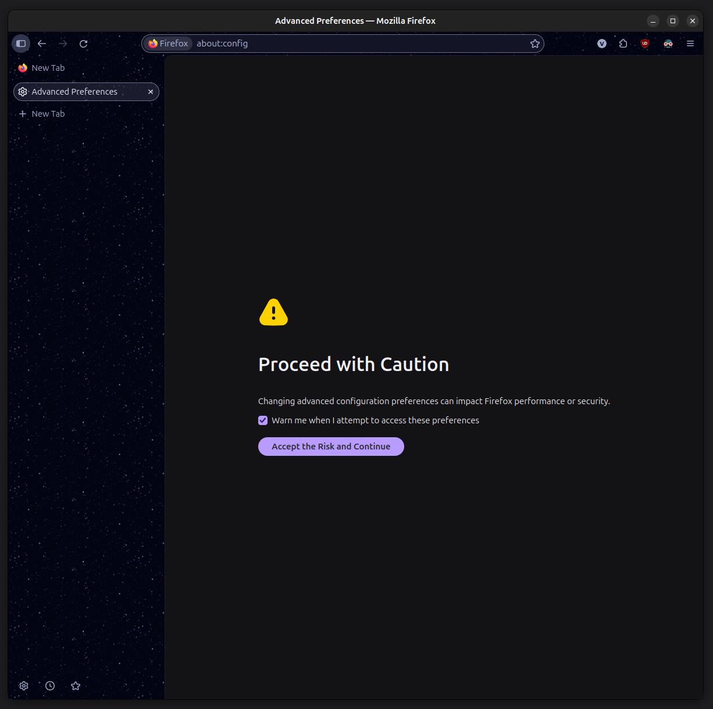
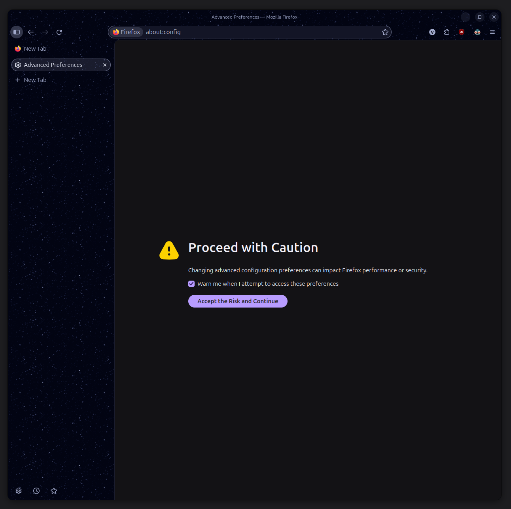

# Firefox Title Bar

Replacement title bar for Firefox because native OS title bars are somewhat fugly. Intended to fit firefox themes, including animated/image backgrounds.

| Without | With |
|---|---|
|  |  |

Disclaimer: Vibe-coded.


## Setup

1. In Firefox, open `about:support`. Beside **Profile Directory**, click
   **Open Directory**.
2. Create a `chrome` folder inside the profile if it does not exist.
3. Copy this folder's `userChrome.css` into that profile's `chrome` folder.
   If a stylesheet already exists, back it up and merge these rules instead
   of overwriting unrelated customisations. Remove any older rules for this
   replacement title bar to avoid conflicts.
4. Open `about:config` and set
   `toolkit.legacyUserProfileCustomizations.stylesheets` to `true`.
5. Right-click an empty toolbar area, choose **Customize Toolbar**, and
   uncheck **Title Bar** to disable the native title bar.
6. Fully quit Firefox and reopen it.

The installed location has this structure:

```text
<Profile Directory>/chrome/userChrome.css
```


## Checks and Troubleshooting

If setup steps were followed but you are not able to view changes, below are some troubleshooting checks I ran into:
1. Confirm that the profile directory and the exact filename
`chrome/userChrome.css` are correct
2. Fully restart firefox. This will involve closing all windows.
3. If two title bars appear, disable the native **Title Bar** option.

Other userChrome rules may conflict with this layout.
